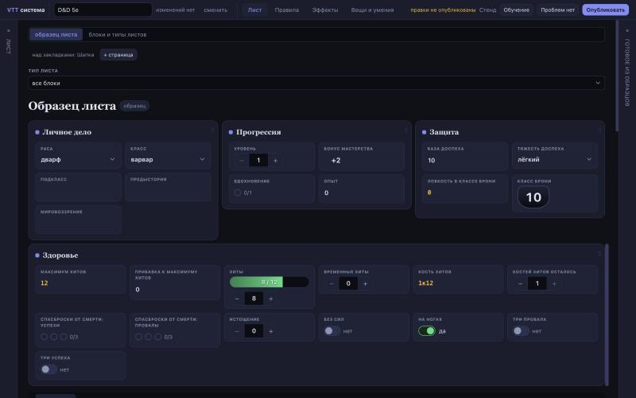
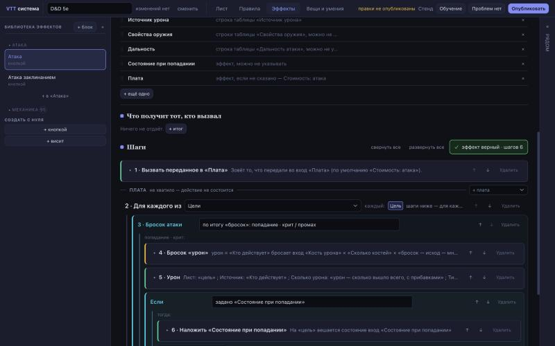
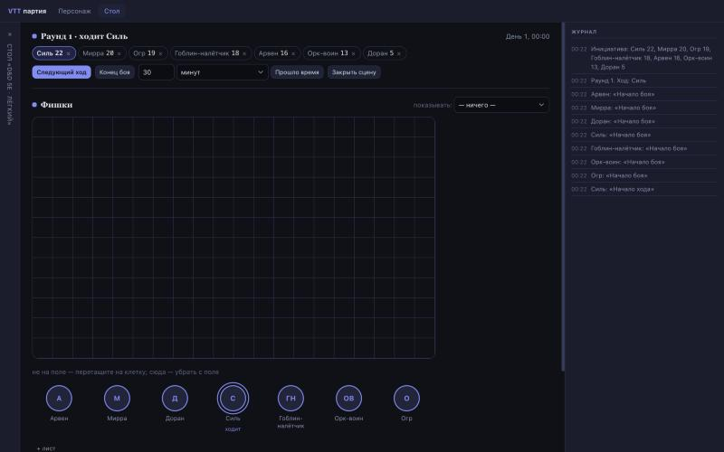

# VTT — конструктор ролевых систем

Собрать свою настольную ролевую систему без программирования: лист персонажа, формулы, кости, таблицы,
эффекты и состояния. Потом сесть за стол и играть по ней, а считать всё будет программа.

Система, мир и лист персонажа — это данные, а не код. Чтобы добавить новый стат, предмет или правило,
движок править не нужно.



## Что умеет

- **Конструктор системы.** Лист из блоков и полей, формулы на своём языке, кости, таблицы (оружие, заклинания,
  виды урона), эффекты из шагов: бросок, сравнение, урон, наложить состояние, спросить игрока.
- **Проверка системы.** «Проблемы» находят ошибки словами экрана и показывают, где именно: вкладка, эффект, шаг.
  Систему с ошибкой не опубликовать.
- **Стол.** Инициатива, раунды и ходы, фишки на поле, игровое время, журнал. Ход считает сервер, у всех
  игроков он одинаковый.
- **Обучение.** Уроки прямо в интерфейсе: ведут по экрану и проверяют, что шаг сделан.





## Образцы

Шесть систем собраны целиком на данных: D&D 5e, Cyberpunk RED, 13th Age, Blades in the Dark, Daggerheart,
Shadowrun 6. У каждой из них два мира — полный и лёгкий. Ещё есть лёгкие миры Fabula Ultima
и Warhammer 40,000: Imperium Maledictum. Что вошло в Shadowrun и что осталось справкой —
[docs/shadowrun-sample.md](docs/shadowrun-sample.md).

## Запуск

Нужна Node 24 (`.nvmrc`).

```bash
make install   # зависимости и git-хуки
make ts        # сервер :8200 и веб :8300
make ts-seed   # залить образцы (конструктор стартует пустым)
```

Открыть http://localhost:8300 и войти под любым именем. Образцы опубликованы от имени «Стенд».

Ещё:

```bash
make ts-test   # тесты всех пакетов
make ts-check  # проверка типов
```

Одним контейнером (статика, API и вебсокет, база sqlite в томе) — [deploy/](deploy/README.md).

## Устройство

Монорепо на TypeScript.

| Где | Что |
|---|---|
| `packages/engine` | движок правил: язык формул со своим разбором, эффекты, модификаторы, исполнение хода. Не знает ни одного имени стата |
| `packages/schema` | zod-схемы мира и API — одни для клиента, сервера и проверки |
| `apps/server` | NestJS: комнаты, публикация, вебсокет стола, sqlite (`node:sqlite` + drizzle) |
| `apps/web` | React + Vite: конструктор, книга вещей, стол |
| `samples/` | миры-образцы |
| `docs/` | решения и документы модели |

Подробнее — [ARCHITECTURE-TS.md](ARCHITECTURE-TS.md), принятые решения — [docs/decisions.md](docs/decisions.md).

## Что держат тесты

1. Лист персонажа хранит только введённое: сохранение и загрузка дают тот же JSON, вычисленного в нём нет.
2. Формулы ссылаются на стабильные теги, поэтому переименование поля ничего не ломает.
3. Новый стат или предмет с бонусом добавляется правкой данных, без строчки в движке.
4. Одна машина считает любые листы и любые системы.
5. Движок детерминирован: кости, время и номера подаёт сервер, и ход, сыгранный заново по журналу, совпадает.
6. Никакого `eval`: формула — строка данных, разбор свой.
7. Циклическая формула даёт внятную ошибку, а не зависание.
8. Каждое действие каждого листа во всех образцах отрабатывает или отказывает по правилам.

Сознательные упрощения — [docs/production-differences.md](docs/production-differences.md).

## Как делается

Проект делается вместе с Claude Code. Правила работы для него — в [CLAUDE.md](CLAUDE.md) и `.claude/`.
