# Правки броска: как было → как стало

Ветка `claude/roll-edits-screen`, ночь на 14.11.2026. Слева на каждой паре — стенд ветки `cdm` («как было»),
справа — стенд этой ветки («как стало»). Оба стенда работают на копии одной и той же локальной базы, поэтому
системы и эффекты в них одинаковые — отличается только код.

Откуда снимки:

- ваша система **«владик шадуоран»**, эффект **«Поддержание»** (кубики −2 на броски носителя);
- образец **«D&D 5e · полный»**, эффект **«Ему помогают»** (слово «Преимущество» на «Проверку») и словарь
  «Правки броска» («Преимущество» / «Помеха» гасят друг друга).

Почему так сделано — `docs/roll-edits-screen.md`; механизм подробно и с примерами — `docs/roll-edits-explained.md`.

## Как посмотреть самому

| Стенд | Адрес | Что на нём |
|---|---|---|
| «как было» | http://localhost:8302 | ветка `cdm`, база `apps/server/stand.db` основной копии |
| «как стало» | http://localhost:8312 | эта ветка, база `apps/server/stand-branch.db` рабочей копии (копия той же базы) |

- Ваша система: войти как «Влад тест днд» → «Автор системы» → «Продолжить работу» → «владик шадуоран» →
  «Эффекты» → «Поддержание» → щёлкнуть строку «Бросок, бросает носитель: кубики − 2».
- Образец D&D: войти как «Стенд» → «Автор системы» → «Продолжить работу» → «D&D 5e · полный» → «Эффекты» →
  «Механика» → «Состояния» → «Ему помогают» → щёлкнуть строку про «Проверку».
- Ваш стенд (:8301 / :8201) и прод эти два стенда не трогают.
- Остановить оба стенда: скажите в этой сессии «останови стенды» — или командой (гасит только серверы на этих
  четырёх портах и их наблюдателей; к этим портам подключён и сам Claude, поэтому без `-sTCP:LISTEN` нельзя):

```bash
for p in $(lsof -ti tcp:8202,8302,8212,8312 -sTCP:LISTEN); do kill $(ps -o ppid= -p $p) $p; done
```

- Если приложение перезапускалось и стенды не открываются — скажите «подними стенды»: они записаны в локальном
  `.claude/launch.json` основной копии (`vtt-api` + `vtt-web` — «как было», `vtt-branch-api` + `vtt-branch-web` —
  «как стало»; этот файл не в git).
- На стенде ветки я создал стол «D&D 5e · полный» (под «Стенд») — для снимков вопроса и журнала; на стенде «как
  было» ничего не создавал.

## 1. Карточка «Правка вызова» — «Поддержание»

| как было | как стало |
|---|---|
| 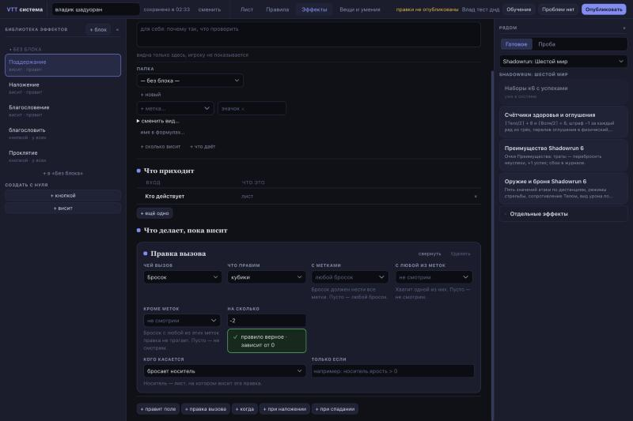 | 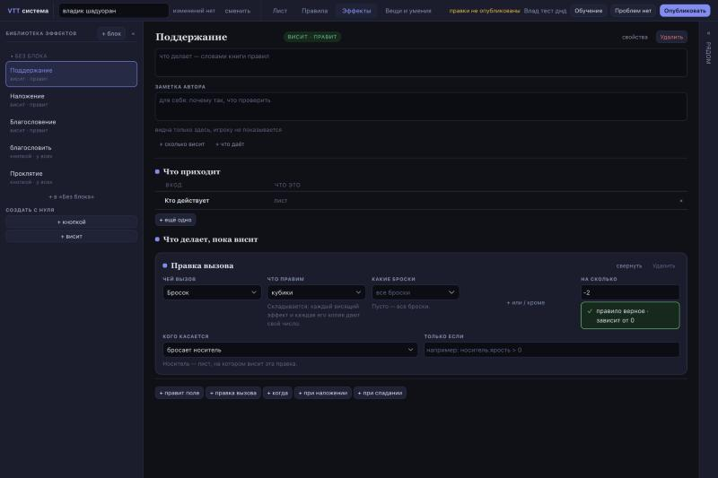 |

- «С метками», «С любой из меток», «Кроме меток» (три поля, у каждого своя подсказка) → одно поле
  **«Какие броски»**; «Или хотя бы одно из» и «Кроме» — по кнопке «+ или / кроме».
- Под «Что правим» — строка, как складывается выбранное: «Складывается: каждый висящий эффект и каждая его
  копия дают своё число». Это ответ на «будет ли −2 за каждое заклинание»: да, кубики складываются.

## 2. Список «к каким броскам»

| как было | как стало |
|---|---|
|  | 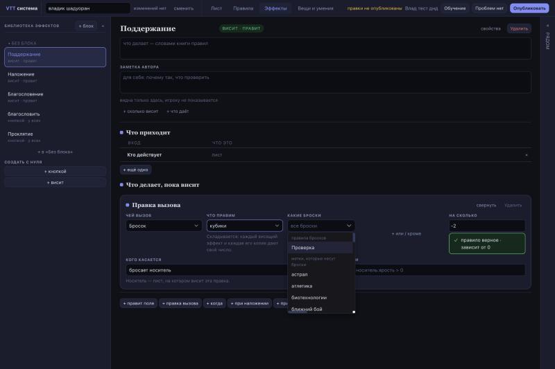 |

- Было: первым в списке шло «проверка» из таблицы «Броски». Ни один бросок вашей системы эту метку не несёт:
  у правила «Проверка» ключ — «бросок». Правка с «проверка» молча ничего бы не делала. А сам ключ правила
  «бросок» терялся среди 556 слов.
- Стало: первая группа **«правила бросков» — «Проверка»** (названием, а не ключом), вторая — **«метки, которые
  несут броски»** (навыки: астрал, атлетика…). Ниже — прежние группы: метки приходят и из книги (оружие,
  заклинание), и формулой, по одной системе их все не узнать.
- Чего нет: «проверка» по-прежнему можно выбрать ниже, в «метки бросков · Броски», и «Проблемы» про неё молчат.
  Замечание «метки нет ни у одного броска» не добавлял: по одной системе не видно меток из книги и формул, и оно
  сработало бы на живых правках образцов (см. «Открытые находки» внизу).

После «+ или / кроме»:

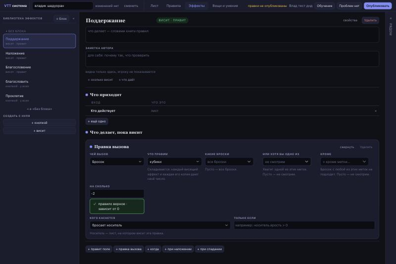

## 3. «Правила → Броски» — «Проверка»

| как было | как стало |
|---|---|
| 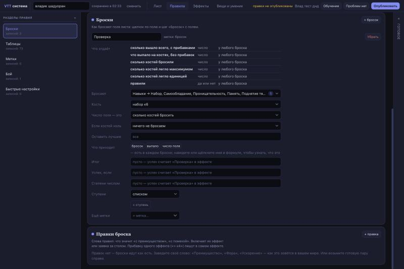 |  |

- Новая строка **«Правят эти броски»**: здесь — «на любые броски: «Поддержание»». Видно с карточки правила, кто
  правит его броски, не обходя все эффекты.

## 4. Карточка «Правка вызова» — «Ему помогают» (D&D)

| как было | как стало |
|---|---|
| 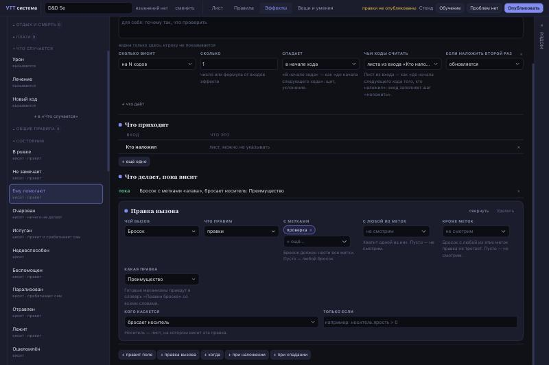 | 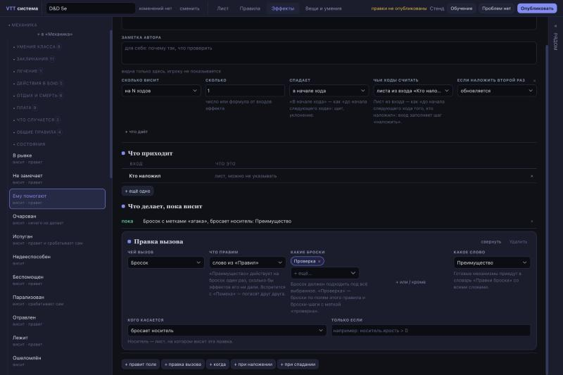 |

- «Что правим: правки» → **«слово из «Правил»»**; «Какая правка» → **«Какое слово»**.
- Под «Что правим» — правило именно этого слова из словаря: «„Преимущество“ действует на бросок один раз,
  сколько бы эффектов его ни дали. Встретится с „Помеха“ — погасят друг друга».
- Фишка «проверка» (ключ) → **«Проверка»** (название правила); свёрнутая строка тоже: «Бросок с метками
  «Проверка»…».

## 5. Список «Что правим»

| как было | как стало |
|---|---|
| 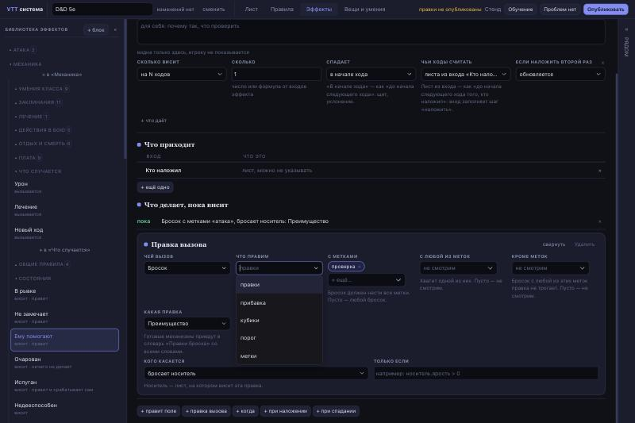 | 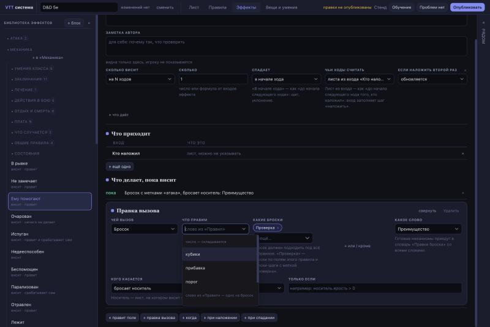 |

- Было: «правки / прибавка / кубики / порог / метки» одним списком — слово и число выглядят одинаково, а
  складываются по-разному.
- Стало: группы **«число — складывается»** (кубики, прибавка, порог), **«слово из «Правил» — одно на бросок»**,
  **«ещё»** (метка броску). Конец списка:

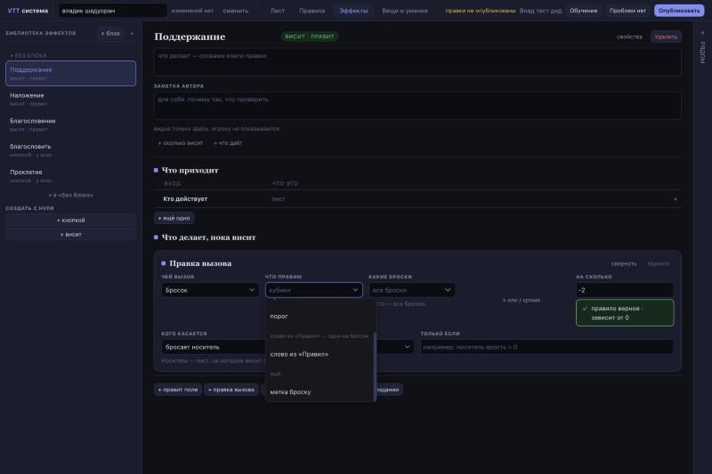

Если в словаре есть слово «по разу от каждого разного эффекта», группа слова зовётся «слово из «Правил» —
считается, как задано там».

## 6. Список слов при правке на «Проверку»

| как было | как стало |
|---|---|
| 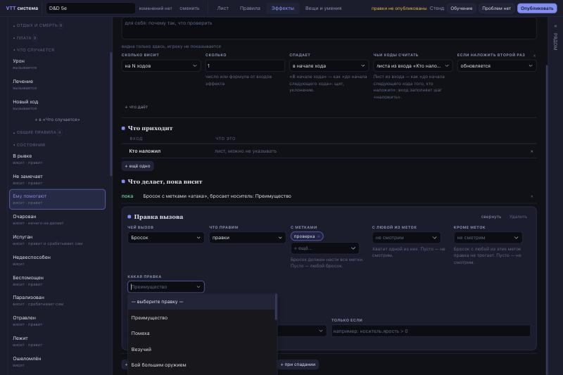 | 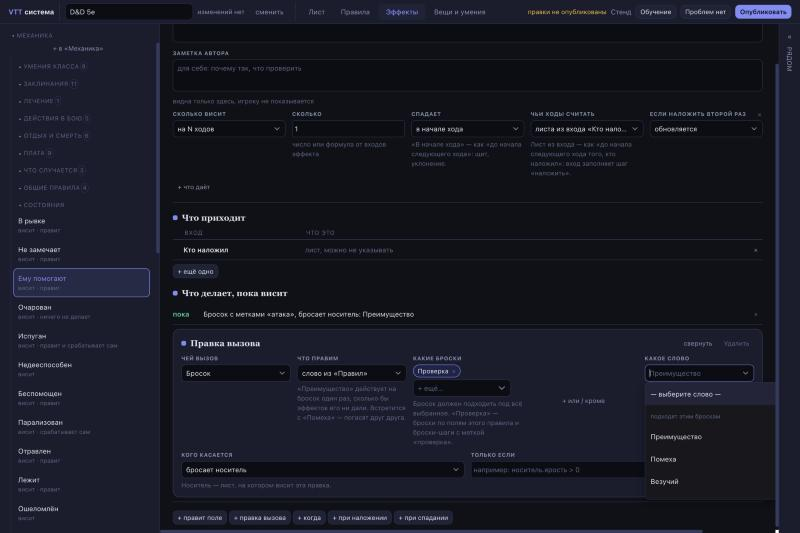 |

- Стало: сначала **«подходят этим броскам»**, потом «не подходят этим броскам». Пример неподходящего: «Кость
  выше» на броске набором к6 со счётом успехов — костям такого броска это слово ничего не сделает. У D&D к20
  подходят все слова, поэтому вторая группа здесь пустая.

## 7. Словарь «Правила → Правки броска»

| как было | как стало |
|---|---|
| 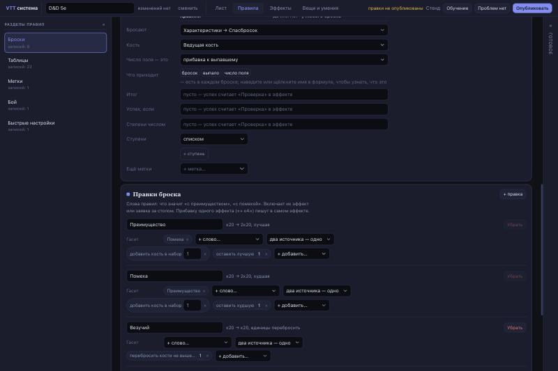 | 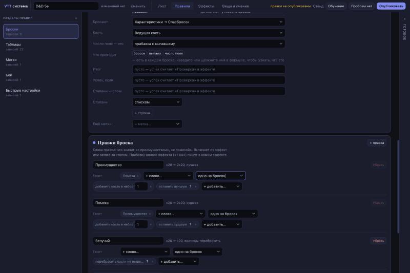 |

- «два источника — одно» / «каждый источник считается» → **«одно на бросок»** / **«по разу от каждого разного
  эффекта»**. Всплывающая подсказка: копии одного и того же эффекта считаются одним (два «Поддержания» дадут
  слово один раз); «за каждую копию» — числом в самом эффекте.

## 8. «Правила → Броски» — «Проверка» (D&D)

| как было | как стало |
|---|---|
|  |  |

- **«Правят эти броски»**: «Ему помогают» — Преимущество, «Испуган» — Помеха, «Отравлен» — Помеха,
  «Истощение» — Помеха.

## 9. Журнал броска

Один и тот же бросок — Арвен (D&D), «Проверка: Сила», кости 15 и 4 — прогнан на движке `cdm` и на движке ветки:

| Что висит на Арвен | как было | как стало |
|---|---|---|
| «Ему помогают» + «Отравлен» | `[15] + 4 = 19` | `[15] + 4 = 19 · погасили друг друга: Преимущество, Помеха` |
| «Отравлен» + «Испуган» | `[15, 4] → 4 (Помеха) + 4 = 8` | без изменений — гасить нечего |
| «Ему помогают» + «Отравлен» + «Испуган» | `[15] + 4 = 19` | `[15] + 4 = 19 · погасили друг друга: Преимущество, Помеха` |

Было: одна кость без пометки — не понять, что преимущество и помеха были и погасили друг друга. Стало:
строка это называет.

За столом (стенд ветки, стол по образцу D&D): на листе Арвен заявил к броску «Преимущество» и «Помеху», бросил
«Проверка: Сила». Сначала вопрос «кости выпали — воспользоваться?» (у Арвен есть «Героическое вдохновение»):

| как было | как стало |
|---|---|
| 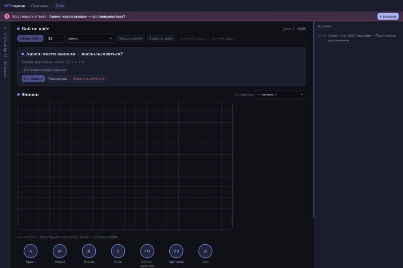 | 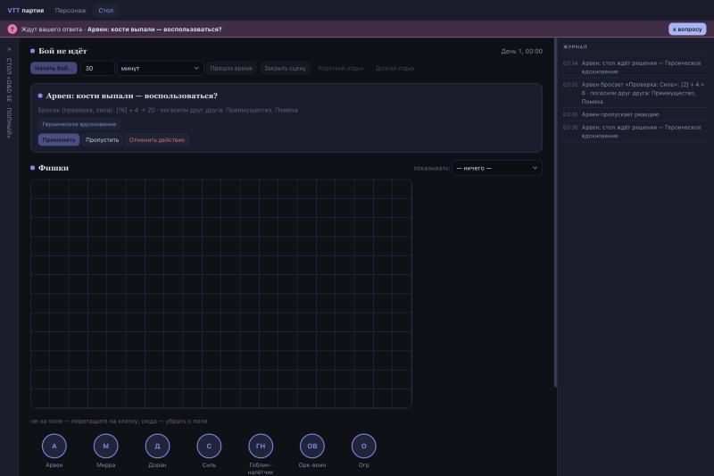 |

- В вопросе: «Бросок (проверка, сила): [2] + 4 → 6» → «[16] + 4 → 20 **· погасили друг друга: Преимущество,
  Помеха**» — видно, почему кость одна, до решения, тратить ли вдохновение. Левый снимок сделан на стенде ветки
  до этой правки — код вопроса тот же, что в `cdm`.

После «Пропустить» — в журнале:

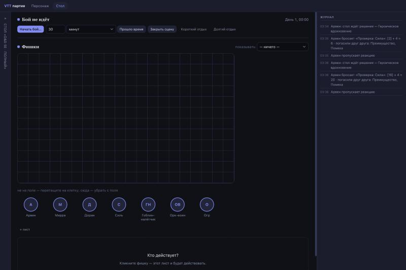

## 10. «Проблемы»: новые замечания

| Когда | Текст |
|---|---|
| Слово не подходит броскам, к которым привязана правка | слово «Кость выше» не подходит броскам, к которым привязана правка («Проверка»: набор: считаем успехи) — на них оно ничего не изменит |
| В «Какие броски» два правила сразу | правка ждёт бросок сразу двух правил («Проверка», «Спасбросок») — так не бывает; возьмите «Или хотя бы одно из» |
| Один якорь в одних эффектах «один», в других «свой на каждое действие» | якорь «Поддержание» в одних эффектах один («Огненный шар»), в других свой на каждое действие («Броня»): действие эффекта с «один» снимает с носителя все копии якоря, и спадает всё, что на них держалось |

В образцах и ваших системах новых замечаний нет.

## Открытые находки (не проверены)

Проба по образцам: правки броска, чьи метки не несёт ни один бросок, известный из самой системы (без книги и
формул). По грубой сверке эти метки приходят из формул в эффектах и из клеток книги, то есть правки, скорее
всего, живые; поштучно не проверял.

| Образец | Эффект | Метки правки |
|---|---|---|
| Shadowrun | «Блокирует» | защита + ближний бой |
| Shadowrun | «Ослепление» | зрение |
| Shadowrun | «Сырость» | сопротивление + холод / электричество |
| Shadowrun · лёгкий | «Матрица: рана и шум» | матрица |
| D&D | «Боевой стиль: бой большим оружием» | урон, оружие, ближний, двуручное |
| Киберпанк RED | «Вживлённые рефлексы» | атака |
| Blades in the Dark | «Бросок без рейтинга» | нулевой (метка ставится формулой) |

Вопрос по книге: выписка (`docs/sr6-sustain.md`, стр. 131) говорит «за каждое поддерживаемое −2 кубика к
проверкам». Образец Shadowrun исключает броски с метками «защита», «сопротивление», «инициатива», а ваше
«Поддержание» в «владик шадуоран» правит все броски носителя. Касается ли штраф защиты и сопротивления, по
выпискам не решить — нужна книга. Если исключать, это «+ или / кроме» → «Кроме».

## Что не менялось

- Как движок считает: числа складываются, слова — по своему правилу, «Преимущество» и «Помеха» гасятся — всё
  как было; новое только в том, что это видно.
- Что хранится: те же ключи правки, переводить данные не нужно, образцы не правились.
